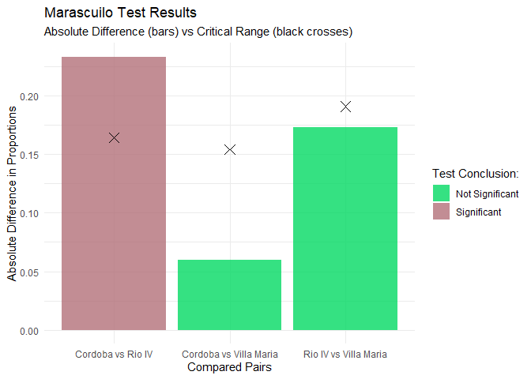

# TFGproject

The goal of TFGproject is to provide an easy and robust implementation
of the Marascuilo procedure for multiple comparisons of proportions,
compliant with standard S3 class architecture.

## Installation

You can install the development version of TFGproject from GitHub with:

``` r
# install.packages("devtools")
devtools::install_github("Rumii18/TFGproject")
```

## Example

This is a basic example which shows how to solve a common problem using
the package’s generic methods:

``` r
library(TFGproject)
library(ggplot2)

# 1. Create a sample dataset
df_ejemplo <- data.frame(
  City = c(rep("Cordoba", 150), rep("Villa Maria", 75), rep("Rio IV", 75)),
  Opinion = c(
    rep("Agree", 115), rep("Disagree", 35),
    rep("Agree", 53), rep("Disagree", 22),
    rep("Agree", 40), rep("Disagree", 35)
  )
)

# 2. Run the Marascuilo test
resultados <- marascuilo_test(
  df = df_ejemplo, 
  col_grupo = "City", 
  col_respuesta = "Opinion", 
  valor_exito = "Agree"
)

# 3. Print the results (using the custom print method)
resultados
#> 
#> --- Marascuilo Procedure Results ---
#> 
#>                               Pair Absolute_Diff Critical_Range    Significance
#> Cordoba...1      Cordoba vs Rio IV        0.2333         0.1644     Significant
#> Cordoba...2 Cordoba vs Villa Maria        0.0600         0.1540 Not Significant
#> Rio IV       Rio IV vs Villa Maria        0.1733         0.1909 Not Significant
#> 
#> ------------------------------------

# 4. Visualize the comparisons (using the autoplot method)
autoplot(resultados)
```



## Sample Data and Shiny Application

The package includes a built-in CSV sample dataset. You can access its
path and load it using `system.file()`:

``` r
ruta_csv <- system.file("extdata", "datos_ejemplo.csv", package = "TFGproject")
datos_csv <- read.csv(ruta_csv)
head(datos_csv)
#>      City Opinion
#> 1 Cordoba   Agree
#> 2 Cordoba   Agree
#> 3 Cordoba   Agree
#> 4 Cordoba   Agree
#> 5 Cordoba   Agree
#> 6 Cordoba   Agree
```

To launch the interactive Shiny web application included in the package,
run the following command in your R console:

``` r
shiny::runApp(system.file("app", package = "TFGproject"))
```
