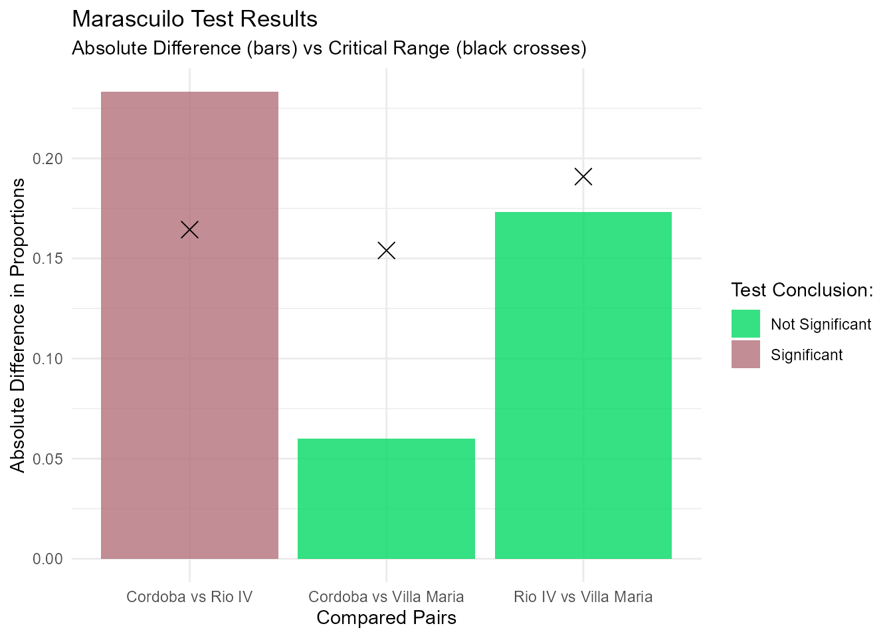

# Tutorial: Marascuilo Procedure

## Introduction

The `TFGproject` package provides an easy-to-use implementation of the
Marascuilo procedure. This test is typically used after a significant
Chi-square test to determine exactly which groups differ from each other
when comparing multiple proportions.

## Setup

First, load the package and `ggplot2` into your environment:

``` r

library(TFGproject)
library(ggplot2)
```

## Example Data

Let’s create a sample dataset representing a survey about a specific
opinion across three different cities:

``` r

df_ejemplo <- data.frame(
  City = c(rep("Cordoba", 150), rep("Villa Maria", 75), rep("Rio IV", 75)),
  Opinion = c(
    rep("Agree", 115), rep("Disagree", 35),
    rep("Agree", 53), rep("Disagree", 22),
    rep("Agree", 40), rep("Disagree", 35)
  )
)
```

## Running the Test

We use the [`marascuilo_test()`](../reference/marascuilo_test.md)
function. We need to specify the dataset, the grouping column, the
response column, and the specific value that represents a “success” (in
this case, “Agree”).

``` r

resultados <- marascuilo_test(
  df = df_ejemplo, 
  col_grupo = "City", 
  col_respuesta = "Opinion", 
  valor_exito = "Agree"
)
```

## Results and Visualization

Because the package uses a custom S3 class architecture, you can simply
print the object to see the results and which comparisons are
statistically significant:

``` r

resultados
#> 
#> --- Marascuilo Procedure Results ---
#> 
#>                               Pair Absolute_Diff Critical_Range    Significance
#> Cordoba...1      Cordoba vs Rio IV        0.2333         0.1644     Significant
#> Cordoba...2 Cordoba vs Villa Maria        0.0600         0.1540 Not Significant
#> Rio IV       Rio IV vs Villa Maria        0.1733         0.1909 Not Significant
#> 
#> ------------------------------------
```

To visually interpret these results, use the
[`autoplot()`](https://ggplot2.tidyverse.org/reference/autoplot.html)
function. It will automatically generate a `ggplot2` chart comparing the
absolute differences against the critical ranges for each pair:

``` r

ggplot2::autoplot(resultados)
```



## Sample Data and Shiny Application

The package includes a built-in CSV sample dataset. You can access its
path and load it using
[`system.file()`](https://rdrr.io/r/base/system.file.html):

``` r

ruta_csv <- system.file("extdata", "datos_ejemplo.csv", package = "TFGproject")
datos_csv <- read.csv(ruta_csv)
head(datos_csv)
#>    Ciudad    Opinion
#> 1 Cordoba De acuerdo
#> 2 Cordoba De acuerdo
#> 3 Cordoba De acuerdo
#> 4 Cordoba De acuerdo
#> 5 Cordoba De acuerdo
#> 6 Cordoba De acuerdo
```

To launch the interactive Shiny web application included in the package,
run the following command in your R console:

``` r

shiny::runApp(system.file("app", package = "TFGproject"))
```
